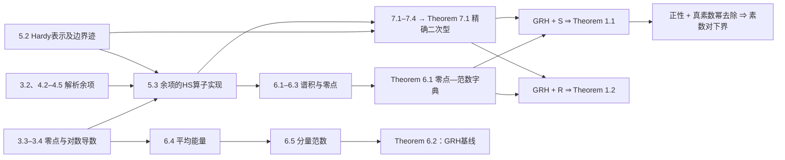

# Li–Liu 定理、定义依赖与沿图复验

[交互依赖图及逐节点审阅](dependency-review.html) · [中文／Lean 对照](review.html) · [全部依赖数据](dependency-graph.json) · [逐项审计记录](dependency-audit.json)

本轮以用户提供的原始 TeX 为主线，覆盖 **38 个命名结论、121 个定义族**。所有显式 Lean 声明均入图：**171 个定义／缩写／结构 + 102 个待证定理 = 273 个声明**。论文证明逐项审阅得到 189 条原始依赖记录；补入显式条件、构造义务、附带结论与数值例证后，论文工作图有 146 个节点、236 条边。Lean 声明引用图有 987 条边。

**两张图的含义不同。** 论文图记录证明使用、定义／条件引用、外部工具和证明推广义务；Lean 图由 elaboration 后的声明类型及定义体提取引用。全部定理仍为 `by sorry`，所以后者不能称为已核验的 Lean 证明依赖图。箭头方向均是“依赖项 → 使用者”，定义引用箭头不表示逻辑蕴涵。

完整性边界：38 个命名环境及 121 定义族全覆盖，包含所有 273 个显式本地声明和它们直接引用的外部常量。没有把每一步未命名代数变形都拆成独立定理，也没有递归展开 Mathlib 的全部实现依赖。类型检查与人工条件复验不构成对原文正确性或形式表述等价性的证明。

## 主结论及主链

核心结果是**有条件、充分大偶数**的加权 Goldbach 渐近式。GRH 加 S 给相对误差趋零；GRH 加更强的 R 给尺度 δ_N 的误差。再补正性与高次素数幂去除，可得素数对数下界。没有得到无条件 Goldbach，也没有证明黎曼猜想或消除 GRH。

这只是主链概览。附录 A 的移动边界、附录 B 的宽权与数值认证、所有定义和外部工具见交互全图。图中的 GRH 基线没有箭头推出 S：基线零自由宽度数量级为 S(N)/(N log N)，S 所需宽度为 h(N)²(log N)³/(N S(N))，二者比值为 h(N)²(log N)⁴/S(N)²；现有基线没有偿还 S 条件。

## 最终产物清单

以下17项按论文主要结论、结构性／附录结论和数值／说明性内容区分；不是把17项全部称为互不依赖的终端定理。完整假设可在交互页展开。

### 1. Theorem 1.1（核心结论）

在 GRH 与预给的谱条件 S 下，得到加权 Goldbach 渐近：\[\mathcal G(N)=c_\phi\mathfrak S(N)+O_\phi\!\left(\frac{\mathfrak S(N)}{h(N)}\right),\qquad \frac{\mathcal G(N)}{c_\phi\mathfrak S(N)}\longrightarrow1.\]隐常数仅依赖 \(\phi\)，与 \(N,h\) 无关；充分大阈值可依赖 \(h\)。

**条件：** 固定非零实权 \(\phi\in C_c^\infty(\mathbb R)\)，支撑在 \([1/3,2/3]\)，满足 \(0\le\phi\le1\)、\(\phi(u)=\phi(1-u)\)；\(c_\phi=\int_0^1\phi(u)^2\,du>0\)。对所有充分大的偶数 \(N\) 假设 \(\mathrm{GRH}(N)\)。预先固定正函数 \(h(N)\to\infty\)，且最终 \(\eta_N=h(N)^2(\log N)^3/(N\mathfrak S(N))\le1/4\)；对充分大且满足 GRH 的偶数，\(\mathfrak X_N(q)\ne0\) 于开半空间 \(\Re q>1-\eta_N\)。

**原文位置：** TeX 273–298、3813–3838。

**尚未覆盖：** GRH和S均为假设，未被本文消除。；只有充分大偶数；有限初始区间未覆盖。；所有Lean证明仍是sorry。

### 2. Theorem 1.2（核心结论）

在 GRH 与谱条件 R 下，得到更强的余项：\[\mathcal G(N)=c_\phi\mathfrak S(N)+O_\phi(\delta_N),\qquad \delta_N=\sqrt{\frac{\mathfrak S(N)}N}(\log N)^{3/2}.\]结合 \(\mathfrak S(N)\ll\log\log N\)，余项也趋于 \(0\)。

**条件：** 固定非零实权 \(\phi\in C_c^\infty(\mathbb R)\)，支撑在 \([1/3,2/3]\)，满足 \(0\le\phi\le1\)、\(\phi(u)=\phi(1-u)\)；\(c_\phi=\int_0^1\phi(u)^2\,du>0\)。对所有充分大的偶数 \(N\) 假设 \(\mathrm{GRH}(N)\)。谱条件 R 要求：充分大且满足 GRH 的偶数 \(N\)，\(\mathfrak X_N\) 的每个四元数零点均有实部 \(1/2\)。

**原文位置：** TeX 306–323、3840–3854。

**尚未覆盖：** R不是经典ζ函数的黎曼猜想，而是新造谱乘积的零点条件。；本文未证明GRH或R；余项趋于0使用奇异级数增长界。

### 3. Unnumbered prime-pair consequence（核心结论）

在任一主定理的条件下，充分大的每个偶数都有许多真素数表示：\[\#\{(p_1,p_2):p_1+p_2=N,\ p_i\text{ 为素数},\ N/3\le p_i\le2N/3\}\gg_\phi\frac{\mathfrak S(N)N}{(\log N)^2}.\]这里计数有序素数对。

**条件：** 固定非零实权 \(\phi\in C_c^\infty(\mathbb R)\)，支撑在 \([1/3,2/3]\)，满足 \(0\le\phi\le1\)、\(\phi(u)=\phi(1-u)\)；\(c_\phi=\int_0^1\phi(u)^2\,du>0\)。对所有充分大的偶数 \(N\) 假设 \(\mathrm{GRH}(N)\)。再假设 R，或者存在满足 S 的预给 admissible 函数 \(h\)。

**原文位置：** TeX 325–328、1018–1026。

**尚未覆盖：** 由加权von Mangoldt相关得到真素数对还须去除高次素数幂贡献，并使用每对权≤(logN)²/N；正文未展开这段标准论证。；现声明只是sorry，不应从G>0直接跳到真素数。；未覆盖有限初始偶数，故不是无条件强Goldbach。

### 4. R implies S（结构性／附录结果）

谱条件之间有单向强弱关系：\[\mathrm R\Longrightarrow\mathrm S(h)\quad\text{对每个预给 admissible }h.\]因为 \(1-\eta_N\ge3/4>1/2\)，临界线上的零点不会进入被排除的开半空间。

**条件：** \(h\) 正、沿偶数趋于无穷，且 \(\eta_N\le1/4\) 最终成立；R 与 S 都只针对满足 \(\mathrm{GRH}(N)\) 的充分大偶数。

**原文位置：** TeX 312–313、3850–3852。

**尚未覆盖：** 没有证明S⇒R；某个测试向量上的算术误差小也不推出整个算子范数小。；这是新谱函数条件之间的关系，不是经典RH推出Goldbach的定理。

### 5. Theorem 7.1（结构性／附录结果）

核心桥梁是精确的带符号恒等式：\[c_\phi\mathfrak S(N)-\mathcal G(N)=\langle T_Nv_N,v_N\rangle,\qquad |\mathcal G(N)-c_\phi\mathfrak S(N)|\le\mathcal Q_N\|T_N\|\ll_\phi\|T_N\|.\]

**条件：** 固定非零实权 \(\phi\in C_c^\infty(\mathbb R)\)，支撑在 \([1/3,2/3]\)，满足 \(0\le\phi\le1\)、\(\phi(u)=\phi(1-u)\)；\(c_\phi=\int_0^1\phi(u)^2\,du>0\)。偶数 \(N>e^{10}\) 且 \(\mathrm{GRH}(N)\)；\(\alpha_N=1/\log N,\beta=1/8\)，\(\mathcal Q_N=\|v_N\|^2\)。不需要 S 或 R。

**原文位置：** TeX 3710–3722、3896–3914。

**尚未覆盖：** 这是条件于GRH的精确重写和误差传递；本身未给满足主定理所需的小范数。

### 6. Theorem 6.2（结构性／附录结果）

仅用 GRH 能得到的基线是\[\|T_N\|\le\|T_N\|_{\mathrm{HS}}\ll(\log N)^2,\qquad \eta_N^{\mathrm{GRH}}\asymp\frac{\mathfrak S(N)}{N\log N}.\]它给一个零点排除半空间，但尚不足以让 Goldbach 误差为 \(o(\mathfrak S(N))\)。

**条件：** 充分大偶数 \(N\) 逐个满足 \(\mathrm{GRH}(N)\)；常数与阈值绝对。不需假设其它模数 GRH。

**原文位置：** TeX 2616–2629、284–287。

**尚未覆盖：** “只用GRH”仍不是无条件。；所需S宽度与此供给宽度之比约为h(N)²(logN)⁴/S(N)²；现有分量分别估计未补上这一差距。

### 7. Lemma 7.5（结构性／附录结果）

一般宽度的算术准则为\[\frac{|\mathcal G(N)-c_\phi\mathfrak S(N)|}{c_\phi\mathfrak S(N)}\ll_\phi\sqrt{\frac{(\log N)^3}{N\eta_N\mathfrak S(N)}}.\]因此只要沿所考虑的偶数序列 \(N\eta_N\mathfrak S(N)/(\log N)^3\to\infty\)，便得到相对渐近。

**条件：** 固定非零实权 \(\phi\in C_c^\infty(\mathbb R)\)，支撑在 \([1/3,2/3]\)，满足 \(0\le\phi\le1\)、\(\phi(u)=\phi(1-u)\)；\(c_\phi=\int_0^1\phi(u)^2\,du>0\)。每个所考虑的偶数 \(N>e^{10}\) 满足 GRH，\(0<\eta_N\le1/4\)，且 \(\mathfrak X_N(q)\ne0\) 于 \(\Re q>1-\eta_N\)。

**原文位置：** TeX 3781–3795。

**尚未覆盖：** 仅对满足全部逐点条件的序列成立；不是对所有偶数自动成立。

### 8. Proposition A.1 and A.2（结构性／附录结果）

对每个先固定的 \(c>0\)，可将左边界改为 \(\alpha_{N,c}=c/\log N\)，保持\[c_\phi\mathfrak S(N)-\mathcal G(N)=\langle T_{N,c}v_{N,c},v_{N,c}\rangle.\]并有 \(\mathcal Q_{N,c}\le e^{2c}(2\pi)^{-1}\int_0^\infty |V(u)|^2du/u\)，以及相应的 S、R 余项 \(O_{\phi,c}(\mathfrak S(N)/h_c(N))\)、\(O_{\phi,c}(\delta_N)\)。

**条件：** 固定非零实权 \(\phi\in C_c^\infty(\mathbb R)\)，支撑在 \([1/3,2/3]\)，满足 \(0\le\phi\le1\)、\(\phi(u)=\phi(1-u)\)；\(c_\phi=\int_0^1\phi(u)^2\,du>0\)。\(c>0\) 先固定；偶数 \(N\ge4\)、\(N>e^{10c}\)、GRH(N)。算术余项分别还需 S(N,c;h_c) 或 R(N,c)。\(\delta_N\) 不随 \(c\) 改变。

**原文位置：** TeX 3949–3989、4033–4068、4092–4098。

**尚未覆盖：** 不能直接调用主文固定α声明；需重放一般带证明和新增generic谱字典，仍未证明。；阈值、admissibility及h_c的增长不要求对c一致；不能把固定c后N→∞偷换为N固定c→0。

### 9. Lemma A.3（结构性／附录结果）

在原有估计内，改变边界常数不能消除对数差距：\[\mathcal Q_\alpha\asymp_\phi N^{2\alpha},\quad M_\alpha=C((\log N)^2+\alpha^{-2}),\quad \mathcal Q_\alpha M_\alpha\asymp_\phi(\log N)^2e^{2c}(1+c^{-2}).\]当 \(c\downarrow0\) 或 \(c\to\infty\) 时，最后的 \(c\) 因子均发散。

**条件：** 固定非零实权 \(\phi\in C_c^\infty(\mathbb R)\)，支撑在 \([1/3,2/3]\)，满足 \(0\le\phi\le1\)、\(\phi(u)=\phi(1-u)\)；\(c_\phi=\int_0^1\phi(u)^2\,du>0\)。充分大偶数满足 GRH；对 \(0<\alpha<1/10\) 一致，且代入 \(\alpha=c/\log N\)。宽度比的结论另限于两个实际宽度均 admissible 的情形。

**原文位置：** TeX 4110–4134、4166–4171。

**尚未覆盖：** 仅说明这些已有充分上界的最佳数量级，不证明真正范数的最优常数，也不证明任何方法都不可能改进。

### 10. Proposition A.4（结构性／附录结果）

固定模数的小 \(c\) 极限有真实障碍：\[\liminf_{c\downarrow0}c\|T_{N,c}\|\ge\frac{2C_{N,\gamma}\log N}{1+\gamma^2}>0.\]因而足够小的 \(c\) 下 R(N,c) 失败；任意允许的零点排除宽度满足 \(\eta\le\delta_N^2c^2/(3z_N^2)\)。

**条件：** 固定偶数 \(N\ge4\) 满足 GRH；选择某个奇特征在 \(\rho=1/2+i\gamma\) 的非平凡零点。\(C_{N,\gamma}=2\varphi(N)^{-1}\sum_{\chi\in X_N^-}m_\chi(\rho)^2>0\)。宽度要求 \(0<\eta\le1/4\)，且 \(\|T_{N,c}\|\ge z_N/c\) 的小 \(c\) 域。

**原文位置：** TeX 4181–4208、4265–4267。

**尚未覆盖：** 不否定固定c后N→∞的R/S，也不直接反驳主文c=1假设。；所选零点的存在作为A4显式条件，未在此声明中另证零点存在定理。

### 11. Proposition B.1 and Lemma B.2（结构性／附录结果）

在 \(N=30030\) 有无条件的精确计数重写：\[r_G(N)=\frac N2\mathcal J-\frac{\mathcal C_{\rm pp}}2+\mathcal E,\qquad \mathcal J=\frac1{5760}\sum_\chi\chi(-1)|I_\chi|^2.\]\(I_\chi\) 位于 \(\Re s=1\) 的绝对收敛线上，包含全部特征。

**条件：** 固定 \(N=30030,A=16,L=1000\) 和附录B定义的 \(C^6\) 宽截断 \(\eta\)、\(W\)、\(f=W/\sqrt u\)。有限修正必须按原定义精确计算；不假设GRH、S或R。

**原文位置：** TeX 4316–4327、4366–4378。

**尚未覆盖：** 这是精确公式，不等于已经在Lean执行/认证905。；依赖30030没有素数或素数幂对角项的特殊有限事实，不可原样推广所有偶数。

### 12. Lemma B.3（结构性／附录结果）

无条件的计数证书模板：\[|\mathcal J-\widehat{\mathcal J}|\le2\sqrt{\widehat{\mathcal D}}\,\varepsilon_I+\varepsilon_I^2,\quad r_G(N)\in[\widehat r_G-\varepsilon_r,\widehat r_G+\varepsilon_r]\cap\mathbb Z,\]\[\widehat r_G=\frac N2\widehat{\mathcal J}-\frac{\mathcal C_{\rm pp}}2+\mathcal E,\quad \varepsilon_r=\frac N2(2\sqrt{\widehat{\mathcal D}}\,\varepsilon_I+\varepsilon_I^2).\]

**条件：** \(N=30030\)，指定全部 \(\widehat I_\chi\)；\(\varepsilon_I\ge0\) 且 \(5760^{-1}\sum_\chi|I_\chi-\widehat I_\chi|^2\le\varepsilon_I^2\)。\(\mathcal C_{\rm pp},\mathcal E\) 精确；无需GRH。

**原文位置：** TeX 4443–4473。

**尚未覆盖：** 当前只有一般模板；尚未输入论文stored积分近似、有限变换有理包围、误差上界证书。；主积分A的求积误差在这个证书中消去，不是遗漏误差项。

### 13. Appendix B exact numerical count 905（数值／说明性内容）

论文声称经向外舍入得到\[[904.725241,\ 905.274759]\cap\mathbb Z=\{905\},\]\[r_G(30030)=905\quad\text{（无序）},\qquad 1810\quad\text{（有序）}.\]它是一个固定整数的无条件计数。此次独立Python筛法也复算得905，但这不是Lean证书。

**条件：** 论文数值认证需要实际 \(\widehat I_\chi\) 和有理区间计算证明 \(\varepsilon_I=1.68935\times10^{-5}\) 控制平均误差，并精确计算有限修正。全部条件不含GRH、S或R。

**原文位置：** TeX 4475–4497。

**尚未覆盖：** 当前模块没有905的Lean定理，也没有stored积分数组、根单位包围及逐阶段区间变换证书。；独立有限枚举核查只能作额外复算，不能标成本文形式化已完成。；该固定N结果不能推全体偶数Goldbach。

### 14. Proposition B.4（结构性／附录结果）

同一个算子对宽权残差也有精确解释：\[\mathcal B=\mathfrak S(N)c_f-\mathcal J=\langle T_{N,1}v_W,v_W\rangle,\qquad c_f=\int_0^1 f(u)f(1-u)\,du.\]

**条件：** \(N=30030\)、GRH(N)，\(\sigma_*=1/9\)、\(c=1\)，使用附录的真实宽权 \(f\) 与泛函 \(\ell_W\)。不需R。

**原文位置：** TeX 4500–4535。

**尚未覆盖：** 宽权非对称且仅C6；必须重放适用的反演论证，不能调用主权IsWeight，也不能将cf换为∫f²。；无条件计数与此条件于GRH的Hardy解释是两条不同路径。

### 15. Proposition B.5（结构性／附录结果）

有限矩阵的谱定理给\[X_{30030}(q)=\det\!\left(I-\frac{4q(1-q)}{\delta_N^2}C^2\right)=\prod_{j=1}^{2562}\left(1-\frac{4\lambda_j^2}{\delta_N^2}q(1-q)\right).\]它满足 \(X(1-q)=X(q)\)；若 \(\|C\|\le\delta_N\)，则所有复零点实部为 \(1/2\)。

**条件：** 附录谱图语境假设GRH(30030)使实际核矩阵Hermitian。矩阵按两条边界、2562节点、正梯形权定义；临界线结论还要严格范数界 \(\|C\|\le\delta_N\)。

**原文位置：** TeX 4535–4569。

**尚未覆盖：** 有限维代数结论不含无限算子截断/离散误差估计。；不把2562个近似特征值当成无限算子全谱。

### 16. Appendix B finite spectral experiment（数值／说明性内容）

论文报告有限矩阵近似极端特征值 \(-0.353421,0.357462\)，\(\|C\|/\delta_N\approx0.826864<1\)，\(\delta_N\approx0.432310239587548\)。这展示有限模型临界线零点的数值现象。

**条件：** 固定 \(N=30030\)；谱核的解释仍在GRH语境。近似计算使用有限高度、固定步长和素数截断。

**原文位置：** TeX 4571–4579、4597–4599。

**尚未覆盖：** 论文明确说明cutoff stability及高精度点检查不能控制无限算子截断/离散误差，不能认证R(30030,1)。；当前Lean也未严格认证有限矩阵的数值范数界；B5只给条件定理。

### 17. Section 8 comparisons and non-results（数值／说明性内容）

第8节讨论仿射筛表达 \(F(U^nv)=n(n+2)\) 及 Goldbach 多项式 \(F_N(n)=n(N-n)\)，指出后者要求随 \(N\) 一致的估计。它没有证明无条件 Goldbach、经典 RH/GRH 或孪生素数猜想。

**条件：** 这些是方法比较与未来研究讨论，不是进入主证明的定理假设或已证终点。

**原文位置：** TeX 3859–3920。

**尚未覆盖：** 没有“先借GRH/S/R再还上”的去条件化证明。；本文只证明条件传递与若干独立有限/解析结果；无法由谱函数的对称性推出所需范数界。

## 沿依赖链发现和处理的实质问题

1. **附录 A 的谱字典复用需要推广。** 主文6.1固定 α_N=1/log N，A.2使用 α=c/log N，不能直接实例化。新增 `theorem_6_1_abstract_dictionary`，在完整复Hilbert空间上，以 `Nonempty (SpectralData T)` 和 δ_N>0 为前提。A.1提供谱数据，4.3和N≥4提供正尺度，原A.2没有增加假设。独立复核未发现必须修正的陈述错误。`SpectralData`含ℕ索引Hilbert基，因此有限／零维空间不能满足其前提；该接口适用于论文的无限维Hardy模型。证明仍空置。

2. **加权正性到素数对有一个真实的桥梁。** 相关和使用Λ，包含高次素数幂。必须先扣除“至少一项为非素数”的贡献。Mathlib已有ψ−θ恒等式和界，可推出坏项≤(2log N/N)(ψ(N)−θ(N))≤4(log N)²/√N。再用c_φ>0、S(N)>1及每对权≤(log N)²/N得所需下界。这些已有工具已定位，但加权、索引和eventual比较桥梁未证明。

3. **Lemma6.4必须用一般字符投影。** w_X不是主权`IsWeight`，不能直接调用带主权条件的Lemma3.1。当前图连接 `lemma_3_1_odd_orthogonality` 对应的通用有限字符投影式。

4. **B.4必须重放宽权证明。** f可不对称且支撑比[1/3,2/3]宽；c_f=∫f(u)f(1−u)du不能替换成∫f²。原来宽权专用声明保留，图中的7.2、7.4、7.1→B.4明确标为证明推广义务。

5. **没有把展示顺序误作证明顺序。** 5.3不依赖5.4，5.4使用5.3；6.4→6.5→Theorem6.2。3.5所用Mellin反演是外部基础工具，并不依赖后文7.1，因此也没有人为制造环。两张核验图均未检出循环。

6. **构造义务保留为独立节点。** `interiorLine_memLp → interiorLine` 和 `boundaryTraces_exist → boundaryTraces` 是定义的真实前置条件。把它们统统并入Lemma5.2会伪造循环，并掩盖choose之前的存在性义务。总化为零的定义只有在存在性／表示条件成立时才对应原文对象。

7. **数值结论没有冒充形式认证。** 论文称附录B的905已由区间计算认证；当前Lean只有B.3认证模板，没有具体积分近似及有理区间证书。独立普通Python枚举也得到905无序对，但不是Lean证书。有限矩阵的数值谱更不能直接认证无限算子的R。

8. **旧的接口设计待审项仍保留。** 联合亚纯性的共同分母模型、加权Lp Hardy实现、可数基HS/谱、专用正Fredholm行列式、切片零点重数等五类数学编码选择，尚没有与未来一般库接口的等价证明。详见原对照页和semantic-audit.json。

## 新发现的已有项目依赖

原来的跨项目候选不等于已经接通。本轮只读检查得到更准确的适用域：

- **Lemma 3.3: Hadamard difference**：[BombieriVinogradov.SiegelWalfisz.logDeriv_symmetricCompletedLFunction_eq_hadamardConstant_add_tsum](/home/azureuser/liu-wang-ternary-goldbach-lean/BombieriVinogradov/Proof/SiegelWalfisz/ZeroFree/CompletedLogDerivativeConstant.lean:16)。旧inventory只列LFunctionLogDerivativeZeroSum.lean:17的Re s>1普通L版本，不能直接覆盖本条。继续下钻后发现本任意避零点完成L版本，因此不必重做解析延拓；只须规范化、两点相减、索引和求和桥接。
- **completedLFunction normalization**：[BombieriVinogradov.SiegelWalfisz.symmetricCompletedLFunction](/home/azureuser/liu-wang-ternary-goldbach-lean/BombieriVinogradov/Proof/SiegelWalfisz/ZeroFree/CompletedNormalization.lean:16)。本稿completedL χ u=d^((u+1)/2)*χ.completedLFunction u，因此d>0时等于d^(1/2)乘旧函数。这个非零常数不改对数导数或零点解析重数；仍须正式证明复幂指数和索引同构。
- **Lemma 3.3: local zero count**：[LiuWang.Proof.DirichletZeroCount.reference_mass_improved](/home/azureuser/liu-wang-ternary-goldbach-lean/LiuWang/Proof/DirichletZeroCount/Smoothed.lean:97)。同文件147行count_conductor_smoothed是中心全局计数界；对两个此类上界作差不能推出单位窗口O(log(d(|t|+2)))。本正核界取中心t+1/2，对窗口内每项作一致正下界后可导出所需局部计数，须先桥接重数索引和有限性。
- **primitive zeros lie in the strip**：[BombieriVinogradov.SiegelWalfisz.symmetricCompletedLFunction_divisorZeroIndex₀_re_mem_Ioo](/home/azureuser/liu-wang-ternary-goldbach-lean/BombieriVinogradov/Proof/SiegelWalfisz/ZeroFree/CompletedZeroStrip.lean:45)。completed零除子索引到本稿ZeroIndex的支集0<Re rho<1可以利用现有定理；没有GRH前提。
- **Hadamard constant existence**：[BombieriVinogradov.SiegelWalfisz.existsUnique_symmetricCompletedLFunction_hadamardConstant](/home/azureuser/liu-wang-ternary-goldbach-lean/BombieriVinogradov/Proof/SiegelWalfisz/ZeroFree/CompletedHadamardConstant.lean:86)。Hadamard常数不是另加假设；原性和奇性给非主后取此存在性，两点相减时常数消去。
- **Proposition 3.2: unconditional boundary nonvanishing**：[DirichletCharacter.LFunction_ne_zero_of_one_le_re](/home/azureuser/goldbach-lean/.lake/packages/mathlib/Mathlib/NumberTheory/LSeries/Nonvanishing.lean:397)。当u=.5+s且Re u≥1，奇性给χ≠1，直接满足hχs；GRH仅负责strip内的其他分支。
- **Lemma 3.1: Chebyshev estimate**：[Chebyshev.psi_le_const_mul_self](/home/azureuser/goldbach-lean/.lake/packages/mathlib/Mathlib/NumberTheory/Chebyshev.lean:453)。N≥0满足前提，常数log4+4与N无关；与当前互素/权有限和通过项非负比较连接。

- [Chebyshev.psi_sub_theta_eq_sum_not_prime](/home/azureuser/goldbach-lean/.lake/packages/mathlib/Mathlib/NumberTheory/Chebyshev.lean:469)：ψ x-θ x=Σ n∈Ioc 0 floor_nat(x),¬Prime(n),Λ(n)。取x=N，floor_nat(N)=N，直接覆盖整个1≤n≤N而非某个专用window；非素数的Λ只在高次素数幂非零。
- [Chebyshev.psi_sub_theta_le](/home/azureuser/goldbach-lean/.lake/packages/mathlib/Mathlib/NumberTheory/Chebyshev.lean:490)：1≤x → ψ x-θ x≤2sqrt(x)log(x)。N≥4可直接实例化；不需exp3100阈值。
- [Chebyshev.psi_sub_theta_le_mul_sqrt](/home/azureuser/goldbach-lean/.lake/packages/mathlib/Mathlib/NumberTheory/Chebyshev.lean:592)：∃C,∀x, ψ x-θ x≤C sqrt(x)。更强全局O(sqrt N)界；取max(C,1)可确保使用正统一常数。当前模块import Mathlib，基础工具无需跨项目移植。

## 38个命名条目的覆盖

每条完整的边适用审核、量词／域／常数检查在交互图的节点详情和dependency-audit.json中。下表只是索引；“已复验”不表示证明已完成。

| 条目 | 原文依赖记录数 | 当前Lean对应声明数 | 复验摘要 |
|---|---:|---:|---|
| [Theorem 1.1](review.html#statement-theorem-1-1) | 6 | 2 | 6.1与7.1共同支撑1.1；常数统一、eventual 域和正性必须桥接，当前声明未弱化。 |
| [Theorem 1.2](review.html#statement-theorem-1-2) | 4 | 2 | 主误差只需 6.1 和 7.1；R⇒S 是附加直接几何推论，未形成对 1.1 的循环引用。 |
| [Lemma 3.1](review.html#statement-lemma-3-1) | 5 | 2 | 直接基础为全特征正交与 Chebyshev；已有奇投影补充接口，剩余是支集和归一化桥接。 |
| [Proposition 3.2](review.html#statement-proposition-3-2) | 6 | 3 | 主声明域正确；关键桥梁是无条件非消失、primitive Euler 因子、共轭和真正有限维性。 |
| [Lemma 3.3](review.html#statement-lemma-3-3) | 4 | 1 | 来自外部标准定理；已有项目提供强底层工具，但 completed 归一化与重数索引桥梁尚未证明。 |
| [Lemma 3.4](review.html#statement-lemma-3-4) | 5 | 3 | 3.3→3.4需 primitive 传递、Euler校正与配对尾估计；当前条件和常数统一正确。 |
| [Lemma 3.5](review.html#statement-lemma-3-5) | 5 | 4 | 主链为 3.2+3.4+标准Mellin；不把后文重述当作逆向证明依赖。 |
| [Lemma 4.1](review.html#statement-lemma-4-1) | 4 | 4 | 三Beta积分/三个符号/共密度均保留；主要工作是正实变量代换和Euler产品归一化。 |
| [Lemma 4.2](review.html#statement-lemma-4-2) | 4 | 2 | 可直接复用Beta-Gamma正域定理，反射/复制与联合亚纯表示仍需桥接。 |
| [Lemma 4.3](review.html#statement-lemma-4-3) | 7 | 4 | 初始密度与延拓密度严格分离；主要外部债务为Euler积/ζ增长/Mertens及C2>1/2。 |
| [Proposition 4.4](review.html#statement-proposition-4-4) | 4 | 1 | 4.2+4.3与ζ函数方程；已延拓密度是关键，当前定义可按实际证明应用。 |
| [Proposition 4.5](review.html#statement-proposition-4-5) | 4 | 1 | 精确相减链3.2+4.3+4.4可用；需独立证明模型共轭而非误认为4.4已经声明。 |
| [Proposition 5.1](review.html#statement-proposition-5-1) | 4 | 2 | source_domain：Even N, N>exp10, GRH(N), alpha_N=1/logN, beta=1/8; sufficiently-large absolute threshold for Theorem6.2；result：逐边域/归一化检查未发现现有主声明的额外前提或缺失结论。范数、谱和选择对象依赖已列的存在/表示/收敛义务；义务均未证明。；no_proof_completion_claim：True；parameter_reuse：固定参数的语句不自动视为任意c参数语句。 |
| [Lemma 5.2](review.html#statement-lemma-5-2) | 7 | 4 | source_domain：arbitrary real a<b; no GRH needed；result：逐边域/归一化检查未发现现有主声明的额外前提或缺失结论。范数、谱和选择对象依赖已列的存在/表示/收敛义务；义务均未证明。；no_proof_completion_claim：True；parameter_reuse：固定参数的语句不自动视为任意c参数语句。 |
| [Proposition 5.3](review.html#statement-proposition-5-3) | 9 | 3 | source_domain：Even N, N>exp10, GRH(N), alpha_N=1/logN, beta=1/8; sufficiently-large absolute threshold for Theorem6.2；result：逐边域/归一化检查未发现现有主声明的额外前提或缺失结论。范数、谱和选择对象依赖已列的存在/表示/收敛义务；义务均未证明。；no_proof_completion_claim：True；parameter_reuse：固定参数的语句不自动视为任意c参数语句。 |
| [Proposition 5.4](review.html#statement-proposition-5-4) | 6 | 4 | source_domain：Even N, N>exp10, GRH(N), alpha_N=1/logN, beta=1/8; sufficiently-large absolute threshold for Theorem6.2；result：逐边域/归一化检查未发现现有主声明的额外前提或缺失结论。范数、谱和选择对象依赖已列的存在/表示/收敛义务；义务均未证明。；no_proof_completion_claim：True；parameter_reuse：固定参数的语句不自动视为任意c参数语句。 |
| [Proposition 6.1](review.html#statement-proposition-6-1) | 6 | 7 | source_domain：Even N, N>exp10, GRH(N), alpha_N=1/logN, beta=1/8; sufficiently-large absolute threshold for Theorem6.2；result：逐边域/归一化检查未发现现有主声明的额外前提或缺失结论。范数、谱和选择对象依赖已列的存在/表示/收敛义务；义务均未证明。；no_proof_completion_claim：True；parameter_reuse：固定参数的语句不自动视为任意c参数语句。 |
| [Proposition 6.2](review.html#statement-proposition-6-2) | 3 | 3 | source_domain：Even N, N>exp10, GRH(N), alpha_N=1/logN, beta=1/8; sufficiently-large absolute threshold for Theorem6.2；result：逐边域/归一化检查未发现现有主声明的额外前提或缺失结论。范数、谱和选择对象依赖已列的存在/表示/收敛义务；义务均未证明。；no_proof_completion_claim：True；parameter_reuse：固定参数的语句不自动视为任意c参数语句。 |
| [Proposition 6.3](review.html#statement-proposition-6-3) | 5 | 4 | source_domain：Even N, N>exp10, GRH(N), alpha_N=1/logN, beta=1/8; sufficiently-large absolute threshold for Theorem6.2；result：逐边域/归一化检查未发现现有主声明的额外前提或缺失结论。范数、谱和选择对象依赖已列的存在/表示/收敛义务；义务均未证明。；no_proof_completion_claim：True；parameter_reuse：固定参数的语句不自动视为任意c参数语句。 |
| [Theorem 6.1](review.html#statement-theorem-6-1) | 4 | 3 | source_domain：Even N, N>exp10, GRH(N), alpha_N=1/logN, beta=1/8; sufficiently-large absolute threshold for Theorem6.2；result：逐边域/归一化检查未发现现有主声明的额外前提或缺失结论。范数、谱和选择对象依赖已列的存在/表示/收敛义务；义务均未证明。；no_proof_completion_claim：True；parameter_reuse：Theorem6.1新增抽象字典桥接固定和移动条带；不能直接把固定alpha theorem实例化成c≠1。 |
| [Theorem 6.2](review.html#statement-theorem-6-2) | 4 | 1 | source_domain：Even N, N>exp10, GRH(N), alpha_N=1/logN, beta=1/8; sufficiently-large absolute threshold for Theorem6.2；result：逐边域/归一化检查未发现现有主声明的额外前提或缺失结论。范数、谱和选择对象依赖已列的存在/表示/收敛义务；义务均未证明。；no_proof_completion_claim：True；parameter_reuse：固定参数的语句不自动视为任意c参数语句。 |
| [Lemma 6.4](review.html#statement-lemma-6-4) | 10 | 5 | source_domain：Even N, N>exp10, GRH(N), alpha_N=1/logN, beta=1/8; sufficiently-large absolute threshold for Theorem6.2；result：逐边域/归一化检查未发现现有主声明的额外前提或缺失结论。范数、谱和选择对象依赖已列的存在/表示/收敛义务；义务均未证明。；no_proof_completion_claim：True；parameter_reuse：固定参数的语句不自动视为任意c参数语句。 |
| [Proposition 6.5](review.html#statement-proposition-6-5) | 10 | 3 | source_domain：Even N, N>exp10, GRH(N), alpha_N=1/logN, beta=1/8; sufficiently-large absolute threshold for Theorem6.2；result：逐边域/归一化检查未发现现有主声明的额外前提或缺失结论。范数、谱和选择对象依赖已列的存在/表示/收敛义务；义务均未证明。；no_proof_completion_claim：True；parameter_reuse：固定参数的语句不自动视为任意c参数语句。 |
| [Lemma 7.1](review.html#statement-lemma-7-1) | 6 | 2 | 主权全局条件、N≥4偶数、GRH的分支范围与σ域均保持；无GRH的反演/衰减部分单独可用。 |
| [Lemma 7.2](review.html#statement-lemma-7-2) | 5 | 3 | 无需GRH；模型pole抵消与原密度级数收敛域正确区分，双积分绝对收敛已单列。 |
| [Proposition 7.3](review.html#statement-proposition-7-3) | 4 | 2 | 符号P−D−K及负模型值正确，保持N≥4偶数、GRH与任意0<σ≤1/9。 |
| [Proposition 7.4](review.html#statement-proposition-7-4) | 3 | 2 | Q范数证明本身不使用GRH，Lean移除此无关条件有证明依据；N>e10与主权保持，V/Ψ区别正确。 |
| [Theorem 7.1](review.html#statement-theorem-7-1) | 5 | 2 | 同一Hardy空间、固定内部线、复共轭、1/(2π)²和算术误差正负均对齐；GRH仍是前提。 |
| [Lemma 7.5](review.html#statement-lemma-7-5) | 3 | 2 | 分母严格正可从主权及奇异级数推出；η开/闭端点一致；序列条件不偷换成全N的GRH。 |
| [Proposition A.1](review.html#statement-proposition-a-1) | 6 | 2 | 变量c不是固定α主章定理的直接实例；已保留原假设并登记operator_spec移动实现义务。任意c与N范围均对齐。 |
| [Proposition A.2](review.html#statement-proposition-a-2) | 5 | 2 | 新generic谱桥是待证泛化，未新增A2使用者前提；c先固定，C先于h，阈值可以依h；GRH按N局部。 |
| [Lemma A.3](review.html#statement-lemma-a-3) | 4 | 4 | 0<α<1/10上统一性及绝对C均在接口落实；宽度比较仅允许域内，结论只涉及现有充分估计。 |
| [Proposition A.4](review.html#statement-proposition-a-4) | 5 | 2 | N固定与c↓0顺序保持；c0缩小后A1域和点距离均满足，二阶奇性抵消的系数无误。 |
| [Proposition B.1](review.html#statement-proposition-b-1) | 2 | 1 | 专属30030的恒等式；C6而非C∞；有序真幂和无序边缘修正未混用。 |
| [Lemma B.2](review.html#statement-lemma-b-2) | 4 | 1 | 无GRH，全部5760特征，主特征停留3/2绝对收敛线；单位投影和1/N归一化正确。 |
| [Lemma B.3](review.html#statement-lemma-b-3) | 3 | 2 | 条件证书模板，ε≥0、平均误差界、精确修正及整数性完整；并未认证给出的浮点数据。 |
| [Proposition B.4](review.html#statement-proposition-b-4) | 5 | 2 | 仅GRH而不需R；宽权专用证明义务，不经过IsWeight；cf非∫f²，角色保持。 |
| [Proposition B.5](review.html#statement-proposition-b-5) | 3 | 1 | GRH为本节谱构造语境，另需\|\|C\|\|≤δ才得临界线结论；不推出无限算子R。 |

## 121个定义族的覆盖

每个定义族映射到实际声明；族可有多个声明。全部171个显式定义／缩写／结构已覆盖。Lean图保留逐声明引用，不把同族折叠造成伪边或伪环。

| 定义族 | 当前声明数 | 复验摘要 |
|---|---:|---|---|
| [weight](review.html#definition-weight) | 1 | 原始权函数条件已完整，非空性和正积分是后续除法的真实前置义务。 |
| [vonMangoldt](review.html#definition-vonmangoldt) | 1 | 直接复用Mathlib的实值Λ，0和1的特殊值必须在有限求和转写时处理。 |
| [singularSeries](review.html#definition-singularseries) | 1 | 复用已有Liu奇异级数时乘2，p=2归一化不可省。 |
| [twinPrimeConstant](review.html#definition-twinprimeconstant) | 2 | C2使用已证明收敛的真实Euler积；仅正性不足以替代论文后续的>1/2。 |
| [goldbachCorrelation](review.html#definition-goldbachcorrelation) | 2 | G保留1/N、互素和双权，有限截断须以权支集证明；PrimePairCount另需素数幂移除。 |
| [weightMass](review.html#definition-weightmass) | 1 | c_phi的定义正确；其严格正性是渐近比值的必要桥梁。 |
| [GRH](review.html#definition-grh) | 1 | GRH仅约束导子整除N的本原L之非平凡零点，必须配合无条件非消失。 |
| [admissibleH](review.html#definition-admissibleh) | 4 | eventual域只沿充分大偶数，常数与阈值依赖必须区分。 |
| [hypothesisWidth](review.html#definition-hypothesiswidth) | 1 | eta=h²log³/(NS)，不是任意存在一个零自由宽度。 |
| [HypothesisS](review.html#definition-hypothesiss) | 1 | S(h)保留预先给定的h与GRH条件化，不能以存在任意细条带替代。 |
| [HypothesisR](review.html#definition-hypothesisr) | 1 | R为实际四元数谱整函数所有零点的实部条件。 |
| [oddCharacters](review.html#definition-oddcharacters) | 2 | 有限集合包含全部奇特征，包括非本原；零延拓继承自Mathlib。 |
| [characterPolynomial](review.html#definition-characterpolynomial) | 1 | Pχ有精确1/sqrt N尺度；有限求和与原式需要支集桥梁。 |
| [companionWeight](review.html#definition-companionweight) | 1 | Φ(u)=sqrt(u)φ(u)，支集远离0使其全局光滑。 |
| [diagonalMoment](review.html#definition-diagonalmoment) | 1 | D(N)=1/N带互素的Λ²φ²和，有限截断正确但需权条件。 |
| [characterMoment](review.html#definition-charactermoment) | 1 | P(N)是实值的2/φ(N)奇特征平方范数和。 |
| [characterKernel](review.html#definition-characterkernel) | 4 | 核用双全纯变量约定；把第二变量共轭后才是Hermitian核。 |
| [mellinWeight](review.html#definition-mellinweight) | 1 | Mathlib mellin与原正半轴u^{s-1}规范一致，可积/快速衰减须证明。 |
| [verticalIntegral](review.html#definition-verticalintegral) | 2 | 向上的归一化竖线积分以高度t参数化，1/(2π)正确。 |
| [signedFamilies](review.html#definition-signedfamilies) | 3 | 三族独立定义保留正整数k和+,+,-解释；不把权支集先塞进核。 |
| [signedBeta](review.html#definition-signedbeta) | 1 | K_-由三个Beta积分组成，域内公式与全局亚纯Gamma形式需区分。 |
| [betaFunction](review.html#definition-betafunction) | 2 | Beta积分、Gamma商和初始域各有职责，不能全平面按点值等同。 |
| [gammaRatio](review.html#definition-gammaratio) | 1 | X1参数为(3/2∓s)/2，商的总化值不得当作极点值。 |
| [diagonalSeries](review.html#definition-diagonalseries) | 1 | D_N是Λ²的绝对级数，仅Rew>0的解析结论有效。 |
| [densitySeries](review.html#definition-densityseries) | 2 | 初始密度tsum与Euler延拓是不同对象，通过Rew>1等式连接。 |
| [densityEulerProduct](review.html#definition-densityeulerproduct) | 1 | P_N为p>2且p不整除N的Euler乘积，需正常收敛保证有效。 |
| [betaModel](review.html#definition-betamodel) | 2 | K_N使用已延拓密度，连续模型和实际相关仍由残差连接。 |
| [continuedBetaModel](review.html#definition-continuedbetamodel) | 1 | 函数方程后的模型含ζ(1-s-z)，消除了原式w=1表观极点。 |
| [residualKernel](review.html#definition-residualkernel) | 1 | E=P-D-K是精确差，任何范数上界须后续证明。 |
| [analyticDomain](review.html#definition-analyticdomain) | 1 | Omega固定为两个0<Re<3/2条带的积，和变量域只能由它推出。 |
| [logarithmicDerivative](review.html#definition-logarithmicderivative) | 1 | gχ(s)=L'/L(.5+s)为正对数导数，Dirichlet级数带负号。 |
| [completedLFunction](review.html#definition-completedlfunction) | 1 | Mathlib已延拓完成函数乘导子幂是正确对象，需与旧项目规范化桥接。 |
| [nontrivialZeros](review.html#definition-nontrivialzeros) | 1 | ZeroIndex以(rho,k)精确计重，但与已证明divisor索引的同构尚待建立。 |
| [zeroMultiplicity](review.html#definition-zeromultiplicity) | 1 | 解析阶数编码原零点重数，非零点为0和有限性均需正则性。 |
| [zeroCount](review.html#definition-zerocount) | 1 | 窗口是[t,t+1)并数重数，有限性在lemma3.3明确声明。 |
| [pairedZeroSum](review.html#definition-pairedzerosum) | 3 | Zχ配对参考点3/2，正常收敛和GRH实虚转换已各有声明。 |
| [eulerCorrection](review.html#definition-eulercorrection) | 1 | eχ补足非本原Euler因子，使用χ*且校正项正号。 |
| [spectralScale](review.html#definition-spectralscale) | 1 | 详见JSON |
| [spectralProduct](review.html#definition-spectralproduct) | 6 | 详见JSON |
| [alpha](review.html#definition-alpha) | 1 | 详见JSON |
| [beta](review.html#definition-beta) | 1 | 详见JSON |
| [sigmaStar](review.html#definition-sigmastar) | 1 | 详见JSON |
| [stripWidth](review.html#definition-stripwidth) | 1 | 详见JSON |
| [hardyStrip](review.html#definition-hardystrip) | 2 | 详见JSON |
| [boundarySpace](review.html#definition-boundaryspace) | 4 | 详见JSON |
| [hardyFunction](review.html#definition-hardyfunction) | 3 | 详见JSON |
| [hardyNormSq](review.html#definition-hardynormsq) | 1 | 详见JSON |
| [boundaryTrace](review.html#definition-boundarytrace) | 3 | 详见JSON |
| [hardyInnerProduct](review.html#definition-hardyinnerproduct) | 1 | 详见JSON |
| [weightedResidualKernel](review.html#definition-weightedresidualkernel) | 1 | 详见JSON |
| [residualOperator](review.html#definition-residualoperator) | 4 | 详见JSON |
| [hilbertSchmidt](review.html#definition-hilbertschmidt) | 1 | 详见JSON |
| [hilbertSchmidtNorm](review.html#definition-hilbertschmidtnorm) | 2 | 详见JSON |
| [eigenvalueFamily](review.html#definition-eigenvaluefamily) | 2 | 详见JSON |
| [spectralR](review.html#definition-spectralr) | 1 | 详见JSON |
| [zeroFreeWidth](review.html#definition-zerofreewidth) | 1 | 详见JSON |
| [widthFromNorm](review.html#definition-widthfromnorm) | 1 | 详见JSON |
| [fueterOperator](review.html#definition-fueteroperator) | 3 | 详见JSON |
| [hardyWeight](review.html#definition-hardyweight) | 1 | 详见JSON |
| [fourierLaplace](review.html#definition-fourierlaplace) | 1 | 详见JSON |
| [evaluationVector](review.html#definition-evaluationvector) | 2 | 详见JSON |
| [boundaryDistance](review.html#definition-boundarydistance) | 1 | 详见JSON |
| [sliceRegular](review.html#definition-sliceregular) | 1 | 详见JSON |
| [quaternionSlice](review.html#definition-quaternionslice) | 2 | 详见JSON |
| [traceClass](review.html#definition-traceclass) | 1 | 详见JSON |
| [trace](review.html#definition-trace) | 1 | 详见JSON |
| [fredholmDeterminant](review.html#definition-fredholmdeterminant) | 2 | 详见JSON |
| [spectralRootParameter](review.html#definition-spectralrootparameter) | 1 | 详见JSON |
| [averagedLogDerivativeEnergy](review.html#definition-averagedlogderivativeenergy) | 2 | 详见JSON |
| [poissonZeroSum](review.html#definition-poissonzerosum) | 1 | 详见JSON |
| [referenceLine](review.html#definition-referenceline) | 1 | 详见JSON |
| [smoothedPerronWeight](review.html#definition-smoothedperronweight) | 3 | 详见JSON |
| [smoothedDirichletPolynomial](review.html#definition-smootheddirichletpolynomial) | 1 | 详见JSON |
| [poissonKernel](review.html#definition-poissonkernel) | 3 | 详见JSON |
| [characterOperator](review.html#definition-characteroperator) | 1 | 详见JSON |
| [diagonalOperator](review.html#definition-diagonaloperator) | 1 | 详见JSON |
| [betaOperator](review.html#definition-betaoperator) | 1 | 详见JSON |
| [diagonalVector](review.html#definition-diagonalvector) | 2 | 详见JSON |
| [rankOneOperator](review.html#definition-rankoneoperator) | 0 | 详见JSON |
| [weightFunctional](review.html#definition-weightfunctional) | 1 | αN<σ<β；N^s、MellinΦ、1+s和上行轮廓1/(2πi)完整，CLM/可积性已有。 |
| [rieszVector](review.html#definition-rieszvector) | 1 | 第一变量线性约定下ell(h)=<h,v>；选择对象由Prop7.4和A1给存在性及真实表示。 |
| [functionalNormSq](review.html#definition-functionalnormsq) | 2 | Q定义为两种实际范数平方，3627–3635给含V²的积分；Lean正确，Prop7.4中文V/Ψ需修。 |
| [residualIntegral](review.html#definition-residualintegral) | 1 | 两个独立向上竖线；N^(s+z)、两Mellin因子、E和(2πi)^−2一致。 |
| [derivativeWeight](review.html#definition-derivativeweight) | 1 | 原名V=Φ−uΦ′；Lean正确；不得与PsiN复积分因子混用。 |
| [differenceConvolution](review.html#definition-differenceconvolution) | 1 | C0的u+y为差族正项；正半轴积分正确。 |
| [sumConvolution](review.html#definition-sumconvolution) | 1 | J0原文[0,y]积分；Lean半轴实现经支集桥接等价，对y≤0也为零。 |
| [signedConvolution](review.html#definition-signedconvolution) | 1 | H0=2C0−J0；其Mellin变换直接复用mellin，无需新空壳定义。 |
| [weightIntegral](review.html#definition-weightintegral) | 1 | a0为φ一阶积分，与cφ二阶质量区分；Lean正半轴积分正确。 |
| [functionalIntegrand](review.html#definition-functionalintegrand) | 1 | Psi_N(s)=N^s MellinΦ(s)(1+s)，与实变量V完全不同；实际定义正确。 |
| [variableAlpha](review.html#definition-variablealpha) | 1 | c>0先固定，α=c/logN；Lean默认c=1与正文对应。 |
| [variableRealization](review.html#definition-variablerealization) | 7 | 同一kernel但空间和边界依赖c；补A1_operator_spec验证变量c实际积分实现。 |
| [variableSpectralProduct](review.html#definition-variablespectralproduct) | 2 | 从T_Nc谱构造且δ_N不随c变；新增A1谱非空验证其选择域。 |
| [variableSpectralHypotheses](review.html#definition-variablespectralhypotheses) | 4 | c先固定、h预给，eventual GRH逐N蕴含；h在无关小模数上的正性不影响eventual结论。 |
| [availableNormMajorant](review.html#definition-availablenormmajorant) | 3 | Mα=C(log²N+α^-2)，C绝对由无φ参数的辅助声明落实。 |
| [zeroMultiplicitySquareAverage](review.html#definition-zeromultiplicitysquareaverage) | 1 | C_Nγ平均奇特征的重数平方，至少一个零点；Lean精确，中文Aγ改原名。 |
| [baselineProductR](review.html#definition-baselineproductr) | 1 | 包含所有p\|N的有限因子和p>2不除N的无限因子；_baseline_product给近零有效域及S R(0)=1。 |
| [experimentN](review.html#definition-experimentn) | 1 | 固定30030=2·3·5·7·11·13，φ=5760，2880奇χ；不外推。 |
| [smoothStep13](review.html#definition-smoothstep13) | 1 | P为j=7..13二项式和，t≤0/≥1分段；C6而非C∞。 |
| [wideCutoff](review.html#definition-widecutoff) | 1 | 原符号η、两分母984、端点16与N−16；Lean正确，B1中文恢复η。 |
| [wideCompanion](review.html#definition-widecompanion) | 1 | 原符号W，√(1−u)、η(Nu)、两对数平方根；支集外零延拓正确。 |
| [wideWeight](review.html#definition-wideweight) | 1 | 原符号f=W/√u；主文IsWeight不能套用；C6/紧支集专用义务已存在。 |
| [wideCorrelation](review.html#definition-widecorrelation) | 1 | J=N^-1有序n+m=N互素和，两个Λ与f；沿用goldbach通用定义无额外窄权。 |
| [unorderedPrimeCount](review.html#definition-unorderedprimecount) | 1 | p≤q、p+q=N、两者素数；Nat计数精确。 |
| [edgeCorrection](review.html#definition-edgecorrection) | 1 | E是p<L的无序素数对补偿1−η(p)^2，无额外1/2。 |
| [primePowerCorrection](review.html#definition-primepowercorrection) | 1 | 有序p^k+q^ell，k,ell≥1且max≥2，互素，分母k·ell；有限范围涵盖所有合法解。 |
| [wideCoefficients](review.html#definition-widecoefficients) | 1 | a_n=Λ(n)W(n/N)/√n，n=0实现0不贡献。 |
| [countingIntegral](review.html#definition-countingintegral) | 1 | Re s=1使L参数3/2，1/(2π)dt，无定义负号；求值负号在B2。 |
| [wideDiagonal](review.html#definition-widediagonal) | 1 | 1≤n<N互素a_n²；代码range N含零但零项严格为0。 |
| [approximateMoments](review.html#definition-approximatemoments) | 2 | 两矩同除5760，全χ；签名χ(-1)取实部等价于±1值。近似矩按4445–4446复用公式。 |
| [wideMainMass](review.html#definition-widemainmass) | 1 | cf=∫0¹f(u)f(1−u)，不擅自改为f²。 |
| [wideMainIntegral](review.html#definition-widemainintegral) | 1 | A=S∫16^{N/2}η²/(logx log(N−x))，lemma_B3_main_integral给NScf/2。 |
| [wideResidual](review.html#definition-wideresidual) | 1 | B=Scf−J，算术误差方向与二次型完全一致。 |
| [momentError](review.html#definition-momenterror) | 1 | ε≥0及平均范数平方≤ε²，HasMomentError与主hypothesis一致。 |
| [approximatePrimeCount](review.html#definition-approximateprimecount) | 1 | N Jhat/2−Cpp/2+E，修正项精确不含A的求积误差。 |
| [countError](review.html#definition-counterror) | 1 | N/2*(2√Dhat ε+ε²)，误差闭区间和整数性在B3完整表达。 |
| [wideFunctional](review.html#definition-widefunctional) | 1 | σ*=1/9、MellinW、1+s，与计数Re s=1积分区分。 |
| [wideRieszVector](review.html#definition-widerieszvector) | 1 | 标准c=1 Hardy空间中表示ellW；B4给存在性/CLM/可积性，选择默认0不被视为证明。 |
| [quadratureNodes](review.html#definition-quadraturenodes) | 1 | 两条边界各1281节点，−40到40步1/16，总2562；排序仅是实现选择。 |
| [quadratureWeights](review.html#definition-quadratureweights) | 1 | 所有权正、每边端点半权1/32、内点1/16；无2π因子。 |
| [finiteSpectralMatrix](review.html#definition-finitespectralmatrix) | 1 | 两平方根权及E(si,conj sj)/((1+si)(1+conj sj))一致。 |
| [finiteSpectralProduct](review.html#definition-finitespectralproduct) | 4 | det(I−4q(1−q)C²/δ²)；谱通过酉相似绑定，opnorm为Euclidean算子范数，GRH下有效。 |

## 验证边界与文件

最终Lean文件在现有goldbach项目的Lean4.35.0和固定Mathlib版本下通过类型检查（退出码0），没有修改两个已有项目。全部102个定理仍含sorry，没有补写证明。抽象谱字典还经过一次独立数学陈述复核；不是Lean证明。

- 原始TeX SHA-256：`0d36bddbed7c6a74a36c7b87a469fdc96f4b4692aa5c95a2890a1c4f5f59b125`。
- 当前Lean SHA-256：`bd3b94f0b7218b1675e5346ba36c05985ab161868f40e8524796912268f34261`。
- [精确声明引用与外部常量](lean-dependencies.json)、[完整图数据](dependency-graph.json)、[逐项复验](dependency-audit.json)、[抽象字典独立复核](abstract-bridge-cross-check.json)、[最终结果清单](final-results.json)。
- [编译记录](typecheck.log)、[验证台账](verification.json)。

历史审计记录中的旧源文件哈希仅标识当时快照；本轮以以上当前哈希、current_lean_locations及verification.json为准。
