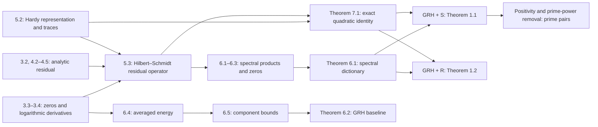

# Dependency review: statement snapshot

The type checks and source hashes recorded here belong to the **pre-rename review snapshot**. Current theorem-type checks are in [reviewed-types.json](../../formalization/reviewed-types.json); [naming-migration.json](../../formalization/verification/naming-migration.json) records the original Git blobs and before/after hashes. [snapshot-migration.json](snapshot-migration.json) records the current snapshot's byte-for-byte match to the Reviewed reference and the unchanged TeX hash.

[Detailed Chinese record](dependency-audit.zh.md) · [Interactive graph](dependency-review.html) · [Graph data](dependency-graph.json) · [Review ledger](dependency-audit.json)

Revision 9 covers **38 named results and 121 definition families**. The paper graph contains **146 nodes and 236 edges**, developed from 189 reviewed source dependencies. The Lean reference graph contains **273 declarations and 987 references**: 171 definitions and 102 theorem statements. At this stage all theorem proofs were placeholders.

Paper edges record mathematical use, definitions, assumptions, and construction obligations. Lean edges record references in elaborated types and definition bodies. Both graphs point from a dependency to its user.

## Main argument

## Theorems and assumptions

Fix a nonzero real weight `φ ∈ C_c^∞(ℝ)`, supported in `[1/3, 2/3]`, with `0 ≤ φ ≤ 1` and `φ(u) = φ(1 − u)`. Write `cφ = ∫₀¹ φ(u)² du > 0` and `δN = √(S(N)/N)(log N)^(3/2)`. The main asymptotics concern sufficiently large even `N` satisfying `GRH(N)`.

| Result | Conclusion and additional conditions |
|---|---|
| Theorem 1.1 | Under the prescribed admissible spectral condition `S(h)`, `G(N) = cφ S(N) + Oφ(S(N)/h(N))`. The implied constant precedes the choice of `h`; the eventual threshold may depend on `h`. |
| Theorem 1.2 | Under spectral condition `R`, `G(N) = cφ S(N) + Oφ(δN)`. |
| Prime-pair consequence | Under either main theorem's hypotheses, the number of ordered prime pairs in `[N/3, 2N/3]` is `≫φ S(N)N/(log N)²`. |
| `R ⇒ S(h)` | Holds for every prescribed admissible positive `h` tending to infinity along even integers, with eventual `ηN ≤ 1/4`. |
| Theorem 7.1 | For even `N > e¹⁰` under GRH, `cφ S(N) − G(N) = ⟨TN vN, vN⟩` and the absolute error is at most `QN ‖TN‖`, with `QN ≪φ 1`. |
| Theorem 6.2 | Under GRH, `‖TN‖ ≤ ‖TN‖HS ≪ (log N)²`; an available zero-free width is `≍ S(N)/(N log N)`. |
| Lemma 7.5 | For `0 < ηN ≤ 1/4` and zero-freeness on `Re q > 1 − ηN`, relative error is `≪φ √((log N)³/(N ηN S(N)))`. The asymptotic follows along sequences with `N ηN S(N)/(log N)³ → ∞`. |

For `S(h)`, the specified width is `ηN = h(N)²(log N)³/(N S(N))`. Its ratio to the supplied GRH baseline width has order `h(N)²(log N)⁴/S(N)²`.

## Appendices

| Result | Conclusion and domain |
|---|---|
| A.1–A.2 | Fix `c > 0`, set `αN,c = c/log N`, and assume even `N ≥ 4`, `N > e^(10c)`, and GRH. The same residual has the variable-strip quadratic identity. The norm bound is `QN,c ≤ e^(2c)/(2π) ∫₀∞ |V(u)|² du/u`; S/R give errors `Oφ,c(S(N)/hc(N))` and `Oφ,c(δN)`. |
| A.3 | Uniformly for `0 < α < 1/10`, `Qα ≍φ N^(2α)`. With `Mα = C((log N)² + α⁻²)` and `α = c/log N`, `Qα Mα ≍φ (log N)²e^(2c)(1 + c⁻²)`. The two actual widths are compared on their common admissible domain. |
| A.4 | Fix even `N ≥ 4` under GRH and a chosen odd-character zero `1/2 + iγ`. Then `liminf(c→0+) c ‖TN,c‖ ≥ 2 C_N,γ log N/(1 + γ²) > 0`, where `C_N,γ = 2/φ(N) Σodd mχ(1/2+iγ)²`. For the stated small-`c` domain, R fails and an admissible zero-free width satisfies `η ≤ δN²c²/(3zN²)`. |
| B.1–B.2 | At `N = 30030`, `rG = NJ/2 − Cpp/2 + E` and `J = (1/5760) Σχ χ(−1)|Iχ|²`, using every character and the actual wide cutoff. These identities require no GRH hypothesis. |
| B.3 | If `ε ≥ 0` and `(1/5760) Σχ |Iχ − Îχ|² ≤ ε²`, then `|J − Ĵ| ≤ 2√D̂ ε + ε²`. The integer count lies in `[r̂ − εr, r̂ + εr]`, where `r̂ = NĴ/2 − Cpp/2 + E` and `εr = N(2√D̂ ε + ε²)/2`. |
| B.4 | Under `GRH(30030)`, the wide-weight residual is `B = S(N)cf − J = ⟨TN,1 vW, vW⟩`, with cross mass `cf = ∫₀¹ f(u)f(1−u) du`. The weight is `C⁶` with compact support in `(0,1)`. |
| B.5 | The 2562-node Hermitian matrix has `X(q) = det(I − 4q(1−q)C²/δN²) = ∏j(1 − 4λj²q(1−q)/δN²)`. It satisfies `X(1−q)=X(q)`; `‖C‖ ≤ δN` puts every complex zero on `Re q = 1/2`. The arithmetic matrix is interpreted under GRH. |

The paper reports the interval `[904.725241, 905.274759]`, whose only integer is 905, and finite-matrix extreme eigenvalues approximately `−0.353421` and `0.357462`. The specific integral-error and finite-matrix certificates remain numerical tasks. A later [Lean enumeration certificate](../../formalization/verification/independent-audit/appendices/NumericCrossCheck.lean) proves the count 905 directly.

Section 8 discusses affine-sieve expressions `F(Uⁿv)=n(n+2)` and the family `FN(n)=n(N−n)`, including the need for estimates uniform in `N`.

## Review findings

- The variable-strip argument uses the extracted abstract spectral dictionary, together with actual spectral data and a positive scale.
- Passing from the von Mangoldt correlation to prime pairs requires removing higher prime powers. The recorded route uses `ψ − θ` and its square-root bounds.
- Lemma 6.4 uses the general odd-character projection for its smoothed weight.
- Appendix B.4 uses the wide-weight inversion argument and the cross mass `∫f(u)f(1−u)du`.
- The proof order is `5.3 → 5.4` and `6.4 → 6.5 → Theorem 6.2`.
- Interior-line integrability and boundary-trace existence appear as construction prerequisites.

The detailed ledger preserves every named-result edge, definition-family reference, quantifier check, and historical reuse candidate. Current imported dependencies and actual proof references are documented in [the dependency report](../../docs/dependencies.md).
